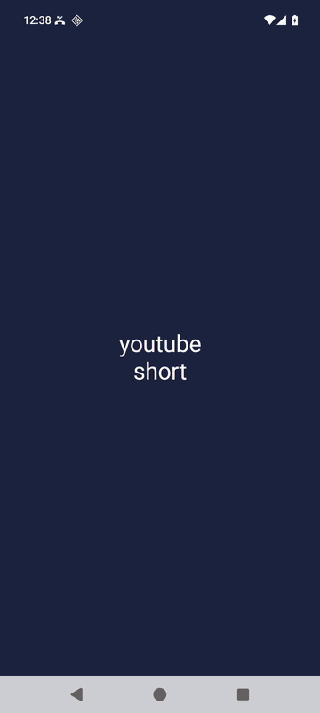
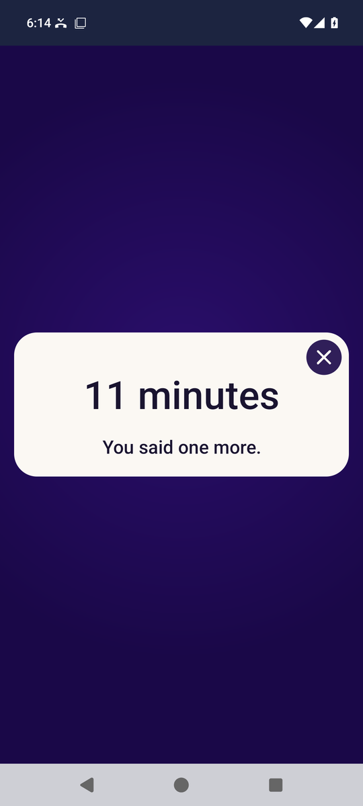
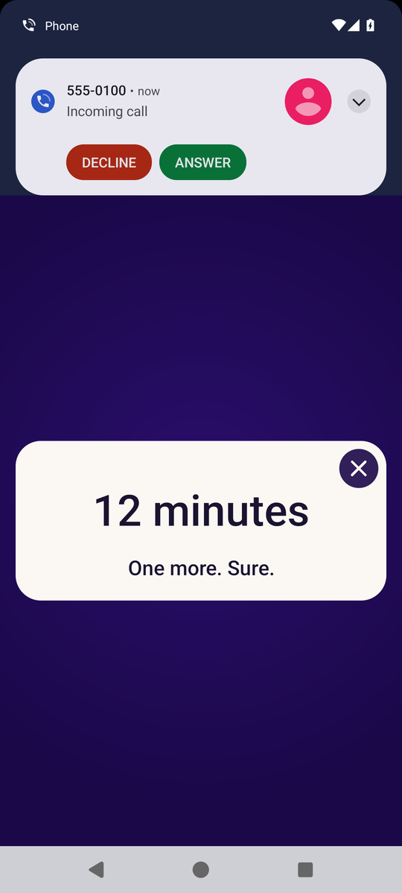

# Nomoredoom

I don't like doom scrolling while I'm working, so blocking short videos is
how I stop it. It keeps me focused on the task at hand.

Nomoredoom is a small Android app that does the blocking. While Claude Code is
working on your computer, opening Instagram Reels, YouTube Shorts or TikTok
covers the video, and memes slam onto the screen one after another, at random
spots and angles, piling on top of each other. There is no X, and it all goes
away when Claude is done.

The rest of the time it leaves your videos alone.

<p>
  
</p>

Installing it takes an AI agent that can reach your phone. One that runs on
the phone itself can, like Hermes inside Termux. So can one on your computer,
like Claude Code, Codex or Cursor. You tell the agent to install Nomoredoom
from this repo. It puts an 82 KB app on the phone and switches it on. You never
open Android Studio. Your part, once: you switch on one setting and read the
agent a six-digit code.

## Popups after a time limit

These are off unless you switch them on, with
`python bin/nomoredoom.py set popups on` or the switch on the app's screen.
Then they come up whenever you watch, not only while Claude works.

<p>
  
  
</p>

| Minutes of short videos | What you get |
|---|---|
| 10 | A small note at the top of the screen. It leaves after 5 seconds. |
| 11 | A meme card over the video. Tap the X to close it. |
| 12 | The X is a 3 second countdown first. The card comes back after every minute of watching, and the video gets a little darker. |
| 14 | A 5 second countdown. The card comes back every 45 seconds. |
| 16 | An 8 second countdown. The card comes back every 30 seconds, and it asks Android to pause the video's sound while it is up. |
| 18 | A 12 second countdown. The card comes back every 20 seconds. |
| 20 | "Going home." Three seconds later you are on the home screen. Open the app again and you get 20 seconds. |

A card has one control, the X in its top right corner. To stop watching you
leave the app the way you always do. The three apps share one count. Time you spend looking at a card is not
counted. Stay away from all three for an hour and the count starts again from
zero.

You can always get out. Home and Back keep working under every card. The
popups stay off the status bar and the phone's own buttons, they move down
when a call comes in so you can answer it, and they disappear when you pull
down the notification shade or lock the phone.

## The memes

Each card is a GIF with the minutes stamped on its corner and one line under
it. The app comes with 27 of them, mocking SpongeBob and the "This is fine"
dog included, and the cards take turns through them.

The pictures are not in this repo, and the phone never downloads them.
[`gags.txt`](app/src/main/res/raw/gags.txt) is a list of lines and GIPHY
links. `install` downloads the GIFs (about 40 MB) to the machine it runs on
and copies them into the app's folder on the phone. The file is yours to
change:

```bash
python bin/nomoredoom.py gags push               # the built-in memes again
python bin/nomoredoom.py gags push my-gags.txt   # your own lines and GIFs
python bin/nomoredoom.py gags reset              # lines only, no GIFs
```

One line of the file is one card: the minutes past the limit, the line, and a
GIPHY link or a GIF file of your own kept next to it. Take a line out and that
meme is gone.

Read a jokes file from someone else before you push it: its lines and
pictures go on top of your videos. The phone checks the lines first, and for a
file it refuses nothing is downloaded or removed.

The app only reads GIFs from its own folder on the phone. It does that on
Android 11 and newer, where other apps cannot write to that folder.
Without the GIFs a card shows its line and the minutes. That is what you get
on an older phone, and when you install by hand on the phone.

## While Claude Code works

```bash
python bin/nomoredoom.py agent link     # with the phone connected, like for install
python bin/nomoredoom.py agent check    # is Claude Code working right now?
python bin/nomoredoom.py agent unlink   # undo both halves
```

`agent link` does two things. It gives the phone the address of a topic on
[ntfy.sh](https://ntfy.sh), a free service that passes short messages along.
The topic's name ends in 24 random characters. Then it adds three hooks to
Claude Code's settings (`~/.claude/settings.json`), the small commands Claude
Code runs at set moments. A copy of the file from before is kept next to it.

From then on, a Claude Code session posts "working" to the topic at the first
tool it uses in a turn, and "done" when the turn ends. Quick answers that use
no tools post nothing. While Reels, Shorts or TikTok is in front, the phone
asks the topic whether any session is working: once when it opens, then every
10 seconds. When one is, the video is covered within a few seconds and the
GIFs on the phone start landing on it: seven in the first second or two, then
one a second, with never more than nine on screen. The line "Stop doom
scrolling" lands on top of them. There is no X, and it asks Android to pause
the video's sound. About 10 seconds after Claude finishes, it is gone.

Stopping Claude yourself counts as finished too: Esc in the terminal, or the
stop button in VS Code or the desktop app. Claude Code runs no hook for that,
but it writes one line to the session's transcript, "[Request interrupted by
user]". While a session works, a small watcher started by the hook reads the
new lines of that file once a second and posts "done" when that line appears.
It reads the file on your computer and sends nothing from it. In a test with a
real session the card was gone 14 seconds after the stop. The watcher ends
with the turn.

A session that stops posting stops counting after 20 minutes. That covers a
crashed session and a laptop that went to sleep. A turn that runs longer than
that posts "working" again every 8 minutes.

ntfy.sh takes 250 messages a day from one internet address. A turn that uses
tools costs two, plus one for every 8 minutes it runs, so about 100 such turns
fit in a day. Past that, the posts are turned away until the next day and the
videos are not covered. You can use a ntfy server of your own
with `agent link --server https://your.server`.

Another agent can do the same with `agent send working` and `agent send done`.

## Install it

### With an agent

Tell the agent:

> Install Nomoredoom on my phone. The steps are in SKILL.md.

The agent also links the phone to Claude Code, after it asks you, because that
step adds three hooks to your Claude Code settings. Until it is linked the app
covers nothing.

The agent needs a way to the phone, and there are three:

- It runs on the phone itself, inside Termux. No computer is needed.
- It runs on a computer on the same Wi-Fi as the phone. Nothing plugs in.
- It runs on a computer with the phone on a USB cable.

For the first two you switch on Wireless debugging and read the agent a
six-digit code. For the third you switch on USB debugging and tap Allow. Both
switches are in Settings > System > Developer options, a menu that shows up
after you tap "Build number" seven times in Settings > About phone.

Either switch lets a program you approve send commands to the phone. The
agent's last command switches Wireless debugging off again, and it tells you
whether that worked. USB debugging is yours to switch off. Nomoredoom keeps
running without either one. [Is it safe](#is-it-safe) has the rest.

An agent that lives in the cloud with no way to your phone, like Meta's Muse,
can only read you the steps under "By hand on the phone".

### With the commands yourself

You need Python 3.8 or newer. The command is `python3` on a Mac or Linux.
Inside Termux, run `pkg install -y python git android-tools libc++` first.

```bash
git clone https://github.com/Mendypf/Nomoredoom.git
cd Nomoredoom
python bin/nomoredoom.py doctor --get-adb   # what is ready and what is missing
python bin/nomoredoom.py install            # put the app and its memes on the phone, switch it on
python bin/nomoredoom.py demo               # play the popups once so you can see them
```

`doctor --get-adb` downloads Google's `adb` from dl.google.com when the
computer has none. To install it yourself instead:

```bash
winget install Google.PlatformTools          # Windows
brew install --cask android-platform-tools   # Mac
sudo apt install adb                         # Debian or Ubuntu
```

`install` downloads the latest release and checks that it is signed with this
project's key before it goes anywhere near the phone. In a clone where you
built the app yourself, it installs your build. Either way it prints the
file's SHA-256 and says who signed it.

Over Wi-Fi, pair before you install and disconnect when you are done:

```bash
python bin/nomoredoom.py pair 192.168.1.20:37123 123456   # the address and the six digits in the phone's pairing box
python bin/nomoredoom.py connect 192.168.1.20:41235       # the address on the Wireless debugging screen
python bin/nomoredoom.py disconnect                       # afterwards: switches Wireless debugging off on the phone
```

On the phone itself, in Termux, `pair 123456` is enough. The tool finds both
ports.

### By hand on the phone

Download `nomoredoom.apk` from the Releases page on the phone and open it.
Android greys out the accessibility switch for apps that came from a file, and
getting past that is a detour through two Settings screens. The app's own
screen walks you through it.

## Settings

```bash
python bin/nomoredoom.py status         # what it sees right now and minutes used
python bin/nomoredoom.py set popups on  # popups after a time limit (off unless switched on)
python bin/nomoredoom.py set limit 15   # minutes before the first popup (1 to 180)
python bin/nomoredoom.py set fresh 90   # minutes away before the count starts over
python bin/nomoredoom.py set home off   # never send me to the home screen
python bin/nomoredoom.py off            # switch it off; the app stays installed
python bin/nomoredoom.py uninstall
```

The popups, the limit and the home-screen switch are also on the app's own
screen.

## What it can see

Android wakes Nomoredoom for three apps and no others. They have four package
names between them: `com.instagram.android`, `com.google.android.youtube`,
`com.zhiliaoapp.musically` and `com.ss.android.ugc.trill` (TikTok has two).
The list is compiled into the app, and nothing you send it later can add to
it.

When one of them changes its screen, Android tells Nomoredoom which window
changed. Nomoredoom opens that window and asks whether a view with a certain
name is showing. For Reels that name is `clips_viewer_view_pager`. It asks
for the names and sizes of views. It never asks for their text, and it cannot
take a screenshot.

The window of any other app stays closed to it. Nomoredoom sees that a window
is there and where its edges are, which is how it keeps the popups off the
status bar and off a call banner.

Android does not enforce any of that. Once an accessibility service is awake,
Android would let it read any window, which is why it warns you about "full
control" when you switch one on by hand. What holds this one back is its own
code. The only code that looks into another app's window is in
[`Looker.kt`](app/src/main/kotlin/io/github/mendypf/nomoredoom/Looker.kt),
about 170 lines, so you can read all of it.

It has no timer running in the background. Outside the three apps it does one
thing: when you unlock the phone it checks whether one of them is in front.
Inside one of them, away from short videos, it looks only when the app's
layout changes, and it waits longer between looks the longer they find
nothing, up to 5 seconds. With a short video in front it looks once a second.

The app has one permission, internet, for one question: is Claude Code
working? It asks only after `agent link`, and only while a short video is in
front. The question is the topic's address and nothing else. Nothing about the
phone, the screen or your minutes goes with it, and the only code that goes
online is
[`AgentLink.kt`](app/src/main/kotlin/io/github/mendypf/nomoredoom/AgentLink.kt).
Because it asks only while a short video is in front, the times it asks
show ntfy.sh, and anyone who can see your Wi-Fi traffic, when and for how long
you watch short videos, though not which ones. Before `agent link`, and after
an `agent unlink` with the phone connected, the app never goes online. A test
fails if any other permission is added, and another if code outside
`AgentLink.kt` reaches for the network.

It keeps your settings and the minutes per screen (Reels, Shorts, TikTok) for
the last 14 days, in the app's own storage. Only a computer you have paired
can ask for any of that: `status` reports the screen in front and today's
minutes.

It does not claim to be a tool for a disability, because it is not one.
Android 17 has an Advanced Protection setting that lets only such tools use
accessibility. On a phone with that setting switched on, Android refuses to
run Nomoredoom.

## Is it safe

The install needs one powerful setting switched on for a few minutes. The
agent's last command, `disconnect`, switches it off again, and you can check
that it did.

### The setting you switch on

Wireless debugging is a setting Google built into Android for app developers.
Switched on, it lets a program you approve with the six digits send commands
to your phone over your Wi-Fi. That program can then do almost anything you
could do with the phone in your hand.

- Do it on your home Wi-Fi, not on a public one. The tool only connects to an
  address on a home network, like 192.168.1.20.
- The agent's instructions tell it to run this tool's commands and nothing
  else. The tool is one file, [`bin/nomoredoom.py`](bin/nomoredoom.py), and you
  can read what each command sends.
- The last command is `disconnect`. It switches Wireless debugging off on the
  phone and reports what it then saw. If it could not see the setting go off,
  it says so and the agent asks you to look. Android also switches it off by
  itself when Wi-Fi drops or the phone restarts.
- Look for yourself afterwards. Settings > System > Developer options >
  Wireless debugging should be off.
- With a cable the setting is USB debugging. The tool is talking through it,
  so it cannot switch that one off. Switch it off yourself when you are done.

### What the install switches on

Switching on an accessibility service by hand takes a detour for an app that
came from a file. Android greys the switch out first, then shows a box saying
the service can view and control the screen. `install` does both from the
computer: it lifts that block for this one app and switches the service on.

You do not see Android's box that way, so read
[What it can see](#what-it-can-see) before you say yes. The agent's
instructions tell it to say this and wait for your yes before it installs.
Installing by hand on the phone keeps Android's own screens.

### What stays on the phone

One app of 82 KB whose one permission is internet, one accessibility switch
turned on for it, and 27 GIFs in the app's own folder.

The program you paired stays on a list called "Paired devices". That list
does nothing while Wireless debugging is off. To erase the entry, switch
Wireless debugging on, tap the entry, tap Forget, and switch it off again.

To take it all off, hold the Nomoredoom icon, tap App info, tap Uninstall. That
removes the app, its switch and its GIFs. To hide the Developer options menu
again, switch it off at the top of its own screen.

### What the tool downloads

- Google's `adb`, from dl.google.com, and only when you ask for it with
  `--get-adb`.
- The app, from this repo's Releases page. The tool refuses to install it
  unless it is signed with this project's key, whose SHA-256 fingerprint is
  `906ec86208a210b13f67aedd9c1a8314ce669afdd3c2034e99e9b34fefb16381`. It
  prints the file's own SHA-256 before it installs.
- The GIFs, from GIPHY, by the id in each link. A file has to start like a
  GIF or WebP picture and stay under 12 MB, and one jokes file can bring 100
  at most.

The tool sends nothing about you or your phone anywhere. Like any download,
those three show your IP address to Google, GitHub and GIPHY. Your agent sees
what the tool prints: the phone's model, Android version and serial number,
which of the three apps are installed, and what `status` reports.

After `agent link`, ntfy.sh sees your computer post "working" or "done" with a
tag of eight letters and digits that tells sessions apart, and sees your phone
ask. Both show it your IP address. Anyone who learns the topic's name can see
when Claude Code is working, and could post "working" to cover your videos.
`agent unlink` and a new `agent link` give you a new name. The hooks go in
your own Claude Code settings, so every session on the computer posts, in
every project. To link one project only, pass `--settings` with that
project's `.claude/settings.json`. `uninstall` takes the hooks off too.

## When an update breaks it

Instagram and YouTube rename parts of their screens now and then, and when
they do, Reels or Shorts stop being noticed. The names live in one small text
file, [`rules.txt`](app/src/main/res/raw/rules.txt), and you can replace it on
the phone without rebuilding the app:

```bash
python bin/nomoredoom.py tree              # the names showing in the app in front
python bin/nomoredoom.py rules push my-rules.txt
python bin/nomoredoom.py rules reset       # back to the built-in file
```

TikTok is counted as a whole app, so it does not break this way.

## What it does not do

- It is a nudge. You can switch it off in Settings whenever you like.
- TikTok counts from the moment you open it, messages and profiles included.
- Instagram Lite, TikTok Lite and short videos in a browser are not covered.
- So far it has run on an Android 16 emulator against stand-in apps, with view
  names taken from other open-source blockers. The install from Termux ran on
  that emulator too. So did two installs by Claude Code with only SKILL.md to
  go on: it paired over Wireless debugging, installed the app, and switched
  the setting off again. The card for while Claude Code works ran there too,
  with a real Claude Code session posting through ntfy.sh. I have not yet run
  it against the three apps themselves on a phone.
- The card for while Claude Code works covers a turn, not a whole session.
  While Claude waits for your answer, the videos are not covered.

## Build it yourself

You need JDK 17 or newer and the Android SDK. Android Studio is optional.

```bash
./gradlew :core:test :app:testDebugUnitTest :app:lintDebug :app:assembleRelease
python -m unittest discover -s tests
```

The behaviour lives in `core/`, plain Kotlin with no Android in it: one
function takes what happened and the state before, and returns the state after
and what belongs on screen. `app/` is the thin part Android runs.

`tests/e2e.py` drives an emulator against three stand-in apps that carry the
package names of Instagram, YouTube and TikTok. It opens screens, taps the X,
turns the screen off, pulls down the notification shade and rings the phone. After each step it asks two witnesses what happened: the
app's own report and Android's own list of windows.

## Credits

The view names came from reading open-source blockers and their screen dumps,
among them Scrolless, curbox, Toll and Unscroll. I took the names and none of
their code. The memes are links to GIPHY. MIT licence.
